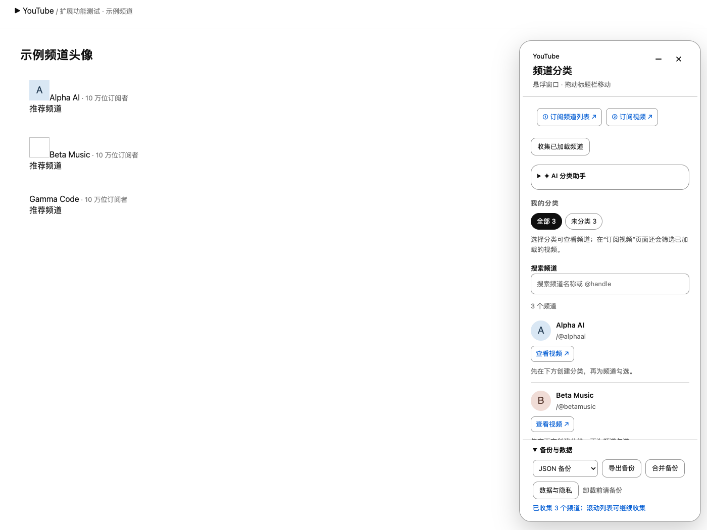
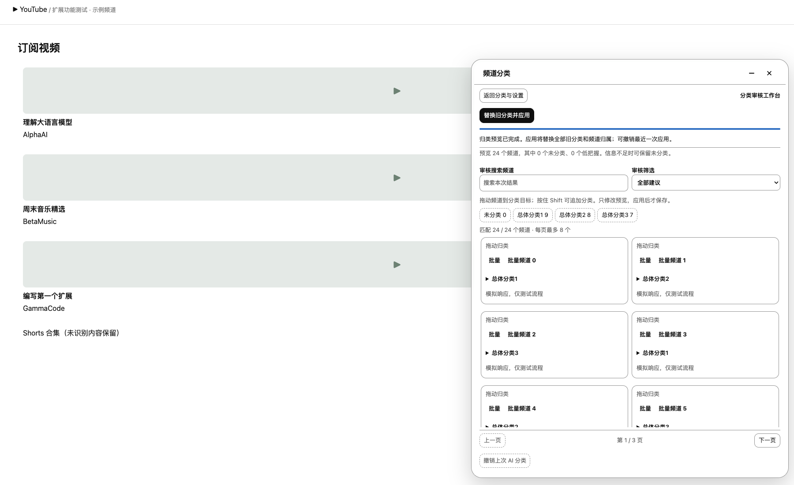
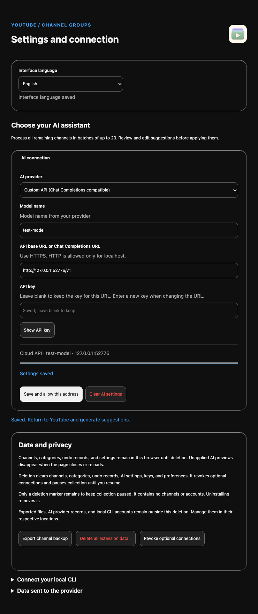

# YouTube 频道分类

**YouTube Channel Groups** is a Manifest V3 extension for Chrome, Edge and Brave. It adds a floating panel to the YouTube desktop site so you can sort your subscribed channels into your own categories, then browse or filter loaded subscription videos by category. AI can suggest categories in batches, either through a local Codex or Claude CLI (via a small macOS Native Messaging helper) or through a Chat Completions–compatible API you choose. You review and edit every suggestion before it is applied, and you can undo the last AI application. Channels, categories and settings stay in your browser; there is no telemetry. The UI is available in Chinese and English: it follows the browser language until you pick one with the 中/EN button in the panel header. Other conveniences: one click auto-scrolls the subscription list to collect every channel and reports whether the list ended; unapplied AI suggestions survive a reload of the same tab; `Alt+Shift+Y` opens or minimizes the panel. An “Unsubscribe…” button on each channel opens YouTube's own unsubscribe confirmation; you confirm in YouTube, never the extension, and the channel is then removed from your list. Install by loading the `extension/` folder as an unpacked extension (see [安装](#安装) below).

<table>
  <tr>
    <td width="40%"></td>
    <td width="40%"></td>
    <td width="20%"></td>
  </tr>
  <tr>
    <td>Floating channel panel</td>
    <td>AI classification review</td>
    <td>Settings (English, dark)</td>
  </tr>
</table>

Screenshots come from the isolated test pages in `tests/browser/` with sample channels and a mock AI service; they do not show real accounts or real model output.

在 YouTube 桌面网页中整理你关注的频道，面向 Chrome、Edge 和 Brave。窗口始终悬浮，不挤压网页；支持标题栏拖动、边框缩放、最小化，以及独立拖动并记住小图标位置。点击图标恢复时，窗口仍保持最小化前的位置、大小和未完成编辑。

频道列表与审核显示频道头像。提供 AI 自动分类、自然语言控制分类数量、分类审核拖放、按分类浏览、中英切换、进度与备份导出。玻璃界面的颜色实时跟随 YouTube。Native Messaging 按需启动本机 Codex 或 Claude 小助手；安装后无需手动启动终端或 Python 服务。也可接入自选云端 API。

## 安装

先下载或克隆本仓库：

```sh
git clone https://github.com/dtjgp/YouTubeChannelGroups.git
cd YouTubeChannelGroups
```

扩展位于项目的 `extension/` 文件夹。加载源码即可使用分类、浏览、备份和云端 API。使用本机 AI 时，还需一次性安装本机小助手，见下文。

1. 在浏览器地址栏输入 `chrome://extensions`。Edge 使用 `edge://extensions`，Brave 使用 `brave://extensions`。
2. 开启页面右上角的“开发者模式”。
3. 点击“加载已解压的扩展程序”，选择项目中的 `extension` 文件夹。
4. 打开或刷新 YouTube。右下角会出现“频道分类”按钮。

如果使用 ZIP，请先解压，再选择其中的 `YouTubeChannelGroups/extension` 文件夹。图形安装器与该文件夹放在同一层。

已安装本机 `extension` 目录的用户：在扩展管理页面点击该扩展的刷新按钮，再刷新 YouTube。加载 ZIP 副本的用户，应先导出备份，再更新同一个扩展目录。不要把新版作为另一个扩展安装，否则两者的数据不会共享。

从旧版本更新至 v0.13.0 只需刷新同一个扩展，无须重新安装本机小助手。若之前未选择过界面语言，界面将改为跟随浏览器语言；可用面板标题栏的“中／EN”按钮切换。

## 最近更新

- **v0.13.0**：新增“取消关注…”按钮，可在面板中逐个取消关注频道。扩展只打开 YouTube 自己的确认框，最后一步由你在 YouTube 中确认；确认后该频道同时从扩展中移除。详见下文“取消关注频道”。
- **v0.12.1**：自动修复已保存的重复频道名称。v0.12.0 只修正了之后收集的名称，已保存的“大聪看电影 大聪看电影”仍会显示两遍。现在扩展在安装或更新后检查一次已保存的频道：名称恰好是“同一段文字重复两次”时，改为只保留一次，不需要重新收集。在扩展管理页面刷新本扩展即可生效。少数本身就重复的真实名称（例如“Duran Duran”）也会被缩短，下次收集该频道时会恢复原名。
- **v0.12.0**：面板标题栏新增“中／EN”语言切换按钮，选择立即保存，并同步到其他 YouTube 标签页和设置页。修复频道名称重复显示（如“ByteByteGo ByteByteGo”）：YouTube 在频道名旁放了一份隐藏的悬停提示文字，旧版本把它也读进了名称。已保存的重复名称会在下次收集时被正确名称覆盖（v0.12.1 起也会在更新后自动修复）。
- **v0.11.0**：一键自动加载全部订阅并显示是否已到列表底部；未应用的 AI 分类建议在同一标签页刷新后恢复；`Alt+Shift+Y` 打开或最小化窗口；首次使用时界面语言跟随浏览器；移除不再使用的 v0.2 HTTP 桥接。

## 键盘快捷键

在 YouTube 页面按 `Alt+Shift+Y`（macOS 为 `Option+Shift+Y`）打开分类窗口；窗口已打开时，同一快捷键将其最小化并保留输入和审核。快捷键只作用于已加载扩展的 YouTube 标签页，不会打开新标签页。可在 `chrome://extensions/shortcuts` 修改或停用；与其他扩展冲突时浏览器可能不分配默认值。

## 移动面板与调整大小

- 按住标题栏空白或文字区域拖动整个面板。移动时保留尺寸，松开后记住位置；关闭按钮不触发移动。
- 标题栏右侧的“−”按钮将窗口最小化为一个圆形小图标。点击图标可恢复原位置、大小、搜索、输入和未应用审核。未移动过图标时，默认位于窗口原来的右下角；全屏时也会隐藏。最小化只影响当前页面；刷新后回到普通入口，已保存的位置与大小继续保留。
- 最小化后按住小图标拖动，可避开视频和字幕。松开后保存图标位置；刷新页面或打开其他 YouTube 标签页后仍会使用它。图标位置与完整窗口的位置、大小分开保存，拖动图标不会移动恢复后的窗口。
- 小图标获得焦点后，方向键移动 20 像素，Shift＋方向键移动 50 像素；Home 恢复默认图标位置，Enter／空格恢复窗口。拖动中按 Esc 可取消。图标自动限制在当前视口内，窗口缩小只临时调整显示位置，放大后恢复保存的位置。
- 面板从打开起就是悬浮窗口，点击视频或页面不会自动收起。你可以把窗口放在视频下方或其他空白区域；不再强制将手动选择的位置推到视频下方。
- 鼠标移到四条边或四个角，光标会变为相应方向的缩放箭头。直接按住边框拖动：左右边调整宽度，上下边调整高度，四角同时调整宽高。尺寸逐像素连续变化；被拖动的边跟随鼠标，对面的边保持不动。触及窗口边界或最小可用尺寸后停止扩大／缩小。
- 标题栏和左上角边框区域可通过 Tab 获得焦点；方向键每次移动窗口或边框 20 像素，按住 Shift 每次移动 50 像素。鼠标拖动过程中按 Esc 可取消本次操作。窗口失焦、改变窗口大小或进入全屏时也会结束并取消进行中的拖动。
- 双击标题栏或任意边框区域，或在对应键盘入口按 Enter／空格，恢复 360 像素宽度、自动高度和默认位置；复位后仍为悬浮窗口。已移除“尺寸”按钮、尺寸设置框和滑杆。
- 调整完成后自动保存尺寸和位置，刷新页面仍会保留，同一浏览器配置文件的其他 YouTube 标签页也会同步。它们不包含在频道导出中。
- 最大尺寸由当前浏览器窗口决定；最小宽度为 320 像素、最小高度为 360 像素，可用空间不足时继续收缩以保持在视口内。常规窗口中标题栏限制在顶部导航下方。网页可用高度不足 480 CSS 像素时，改用 12 像素上边距以保留操作空间。窗口缩小时自动收缩，放大后恢复保存值。悬浮窗口可使用整个网页可用范围，不为其预留侧栏空间。

## 频道头像

频道列表、AI 建议和精简分类审核均显示频道自己的头像。头像来自 YouTube 已加载的订阅频道卡片，或通过“加入当前频道”收集的频道主页。旧频道需要在订阅频道列表中滚动加载一次，才会补充头像；原分类会保留。

头像固定为圆形，按可见范围延迟加载；未收集头像或加载失败时显示频道名称缩写。图片地址更新后自动替换。只接受 YouTube 使用的 `yt3.ggpht.com`、`yt3.googleusercontent.com` HTTPS 地址；不会把头像发送给 AI，也不增加扩展权限。显示图片时会向该图片主机请求资源，不携带页面 Referer。

JSON 备份保留头像地址，仍可读取没有头像字段的旧备份。CSV／Markdown 保持现有文本格式。删除全部扩展数据会清除已保存头像地址；浏览器自身的图片缓存仍由浏览器管理。

## 玻璃界面与页面避让

面板是注入 YouTube 网页的独立浮层，显示在频道列表和普通页面内容上方。它没有嵌入频道列表的布局层。打开、移动、缩放、复位和关闭窗口均不调整 YouTube 页面宽度、边距、网格或视频尺寸。它属于网页内界面，不能移到浏览器窗口之外。

- 使用轻磨砂、圆角、细边框和柔和阴影。材质继续使用 YouTube 当前的颜色。玻璃效果集中在外框，文字和表单使用不透明阅读底色；文字、控件边框和焦点颜色会按对比度要求调整。
- 宽屏和窄屏均使用悬浮窗口，不挤压原网页。没有侧栏模式或页面宽度覆盖规则，默认位于右侧。
- 较窄窗口使用底部浮层。视频可见且下方至少有 260 像素可用空间时，浮层放在视频下方；空间不足时仍可能覆盖部分页面，可拖到其他位置，或使用最小化按钮暂时收起，也可用关闭按钮／Esc 关闭。点击网页时窗口保持打开。
- 全屏播放时隐藏扩展，退出全屏后恢复原来的打开状态。收起和全屏切换不会清空未应用预览或输入。
- YouTube 自己的高优先级菜单和迷你播放器保留显示优先级。分类筛选的“显示全部”按钮移到面板内部，减少页面上的浮动控件。
- “AI 设置”仍在独立浏览器标签页中打开，不嵌入视频区域。
- 支持高对比度和减少透明度偏好；匹配时使用实色表面。减少动态效果偏好会关闭控件过渡。主题切换不使用颜色动画，避免短暂的文字对比度不足。

这是浏览器中的 CSS 玻璃材质实现。设计参考：[Apple Materials](https://developer.apple.com/design/human-interface-guidelines/materials)、[MDN backdrop-filter](https://developer.mozilla.org/en-US/docs/Web/CSS/Reference/Properties/backdrop-filter)。不支持背景模糊时使用实色回退。实际 YouTube 页面变体仍可能需要适配。

## 跟随 YouTube 外观

分类面板以 YouTube 当前页面为准，同步浅色／深色、实际页面背景、文字、卡片、按钮、输入框、边框和操作强调色。无需在扩展中另选主题。即使系统和 YouTube 的主题相反，面板也跟随 YouTube。

正常外观切换和页面颜色变量变化会即时更新。只修改样式表规则、没有产生页面变更事件时，可见页面每秒补查一次。不会修改你的 YouTube 外观设置。

独立“AI 设置”页面跟随最近聚焦的 YouTube 标签页。多个 YouTube 页面分别保留各自的配色，后台页面不会抢占设置页主题。主题同步保留未保存的设置输入和分类预览。

没有打开 YouTube 时，设置页保留上次同步的主题；首次使用、尚未获得 YouTube 主题时才跟随系统。主题只保存在当前浏览器配置文件中。删除全部数据后暂停主题缓存，仍会在当前 YouTube 页面实时显示主题。

## 使用

1. 打开 <https://www.youtube.com/feed/channels>，确认已登录 YouTube。
2. 点击右下角“频道分类”。点击“自动加载全部订阅”，扩展会自动滚动订阅列表，直到不再加载新频道；也可手动向下滚动。
3. 扩展自动收集已经加载的频道。也可点击“收集已加载频道”。自动加载结束后，面板显示覆盖情况：“已到列表底部”表示列表停止增长且 YouTube 不再显示加载项；“列表可能未完”表示仍有加载项或你中途停止，可稍后再试。完成后页面滚动位置恢复。
4. 在“管理分类”中创建分类，例如“AI”“编程”“音乐”。
5. 在每个频道下方勾选分类。同一个频道可加入多个分类。
6. 打开 <https://www.youtube.com/feed/subscriptions>，在面板中点击分类，即可筛选已经加载的订阅视频。
7. 点击面板中的“全部”或“显示全部”，恢复显示。

面板每页显示 20 个频道，支持翻页和搜索全部已收集频道。超过 20 个分类时，频道归属在“编辑频道分类”中展开。分页不减少 AI 处理范围。面板内支持分类重命名和分类删除。在频道主页可点击“加入当前频道”，手动添加该频道。

## 取消关注频道

每个频道下方有“取消关注…”按钮。它修改你真实的 YouTube 订阅，因此每次只处理一个频道，并由你在 YouTube 中做最后确认。

1. 点击频道的“取消关注…”。如果该频道在当前页面上（例如订阅频道列表中已加载的卡片，或该频道的主页），扩展点击 YouTube 的“已订阅”按钮，并在菜单中选择“取消订阅”，打开 YouTube 自带的确认框。如果不在当前页面，扩展会在同一标签页打开该频道主页，再继续这一步；这个待办请求一分钟内有效，只使用一次。
2. 分类窗口会暂时最小化，避免挡住确认框。请在 YouTube 的确认框中点击“取消订阅”。**扩展不会替你点击这个最终确认按钮。**
3. YouTube 的按钮变回“订阅”后，扩展把该频道从频道列表和所有分类中移除，并恢复窗口。如果你在确认框中取消，或两分钟内没有确认，订阅和扩展中的记录都保持不变。
4. 如果 YouTube 显示你已经没有订阅这个频道，扩展会询问是否只从扩展中移除它。

限制：

- 扩展依据按钮上的文字（“已订阅”“取消订阅”“Subscribed”“Unsubscribe”，含繁体中文）识别 YouTube 的按钮，所以只支持中文或英文的 YouTube 界面。无法识别时会提示你在 YouTube 中手动取消订阅，不会尝试其他操作。
- 开发测试使用模拟已登录状态的 YouTube 页面，无法在测试中登录真实账号；YouTube 改版后可能需要适配。首次使用时请确认结果。
- 本页已取消关注的频道卡片在 YouTube 刷新前仍会显示，扩展不会再次收集它。
- 不支持批量取消关注。

## 从分类中选择要看的内容

1. 打开分类面板，在“我的分类”中点击一个类别，例如“AI”。频道列表只显示该类别的频道，也可以继续搜索。
2. 点击某个频道的“查看视频 ↗”，在新标签页打开它的视频列表，再选择想看的视频。点击频道名称可打开频道主页。
3. 想跨频道浏览时，打开 YouTube 的“订阅视频”页面，再点击所需类别。页面会筛选已经加载、能识别频道的视频卡片，可直接选择视频播放。

分类筛选会一直作用于当前页面新加载的视频；不会自动拉取全部历史视频。未识别的 Shorts 合集等卡片保留显示。普通页面跳转或刷新后，分类选择恢复为“全部”；分类归属和面板尺寸仍会保留。

## AI 分类助手

### 分类审核工作台

普通分类和精简分类在首批建议成功返回后自动进入工作台。设置表单暂时隐藏，分类目标、进度、应用操作和翻页按钮留在列表外。较宽面板显示双列卡片，较窄面板使用单列。频道列表单独滚动，每页最多 8 条，分页不会减少实际处理的频道数量。

- 可搜索本次结果，筛选“全部建议”“需复核”“未分类”或具体分类。“需复核”包含尚未人工调整的低把握或空分类建议，不代表统计准确率。
- 拖动频道卡片到上方分类目标，会替换该频道的建议分类；按住 Shift 拖放可追加，最多 3 类。拖到“未分类”可清空建议。分类目标较多时，只在目标区域内滚动。
- 不使用鼠标拖放时，普通建议仍可输入逗号分隔的分类并勾选应用项；精简方案仍可展开卡片中的分类行，使用复选框修改归属。
- 筛选和分页只改变显示，不改变应用范围。普通任务应用本轮各页全部勾选项；精简任务整体应用本轮全部频道。普通任务拖到“未分类”时会同时取消该项勾选。
- 拖放和字段修改仅改变预览，点击应用后才保存。返回“分类与设置”会保留预览、编辑和审核筛选；可通过“打开审核工作台”继续。导出备份等常规功能位于返回后的面板中。
- 窗口特别矮、无法容纳固定控件时，审核区域提供滚动回退。未应用的分类建议在同一标签页刷新后恢复，关闭标签页或浏览器后消失；面板尺寸和位置会保留。

### 根据自然语言精简总体分类

如果分类列表过长，选择“精简分类并重新归类”任务。例如输入：

> 合并成 6 大类。AI 和编程分别保留，投资与商业合并，娱乐类不要细分；信息不足的频道先不分类。

1. 展开“AI 分类助手”，将“任务”切换到“精简分类并重新归类”。
2. 输入分类要求，点击“生成精简方案”。支持 1–20 类，可写“6 类”“4–6 类”“最多 8 类”等常见数量要求。不填写明确数量时，AI 在 1–20 类中规划；其他复杂表达由 AI 理解，需检查预览。
3. 检查方案显示的总体数量和范围说明，可编辑分类名称。若数量或划分不合适，点击“重新规划”修改要求。重复名称或不符合已识别数量约束的模型方案会被拒绝。
4. 点击“按方案自动归类全部频道”。所有批次使用同一套分类，模型返回方案外的新分类时，本批会被拒绝，不会继续增加分类名称。
5. 在自动打开的审核工作台检查归类预览，可拖放频道、筛选及翻页。展开频道下的分类行也可编辑归属，每个频道最多 3 类，也可保留未分类。低把握数量会显示，但本任务会整体应用全部频道，不使用普通建议模式的勾选跳过逻辑。
6. 完成全部批次后，点击“替换旧分类并应用”。旧分类列表和全部已收集频道的归属会一起替换，包括手动分类。频道名称、链接、简介和记录仍会保留。新方案未使用的分类也会保留，因此总体分类数量与方案一致；“全部”“未分类”是筛选入口，不计入总体分类数。

规划阶段发送现有分类名称及最多 100 个频道的名称／简介样本；样本按频道列表均匀抽取，并截短名称和简介。这用于控制总体划分，不代表完整分析所有频道内容。随后归类阶段会分批处理全部已收集频道的名称、地址及已收集简介。规划需要一次额外模型请求；没有自动读取视频内容或观看历史。

归类期间显示真实完成数量，可在本批完成后暂停。失败或暂停后可继续剩余频道，已经完成的结果与编辑保留。必须完成所有频道才能整体应用。未应用方案和预览仅在当前页面保存，刷新后需要重新生成。

应用前会核对频道与分类是否仍与规划时一致；发生后续新增、改名或归属修改时，要求重新规划，不覆盖这些修改。应用后仍可点击“撤销上次 AI 分类”，完整恢复原分类列表和频道归属。撤销记录在刷新后保留；若应用后又修改了频道或分类，撤销会拒绝覆盖。撤销只保留最近一次 AI 应用，后续 AI 应用会替换记录。

沿用现有本机 Codex、Claude 和云端 API 设置，无需重装本机小助手。这里提供流程与数据校验，模型是否准确理解主题和复杂自然语言要求，仍需你检查方案。

### 全部频道重新分类

1. 在分类面板展开“AI 分类助手”。
2. 将“分类范围”设为“全部频道（包括已分类）”。该范围指扩展已收集的频道；未加载的订阅需先收集。
3. 将“处理数量”设为“全部剩余频道（自动分批）”。已在本轮检查过的频道，可点击“从头检查”后重新生成。
4. “补充分类”保留已有分类。“重新分类”会替换勾选频道的全部分类，包括手动分类。
5. 生成、检查并编辑建议，再点击“应用勾选建议”。未勾选频道保持原样。生成过程不修改已保存分类。

应用后可点击“撤销上次 AI 分类”，恢复最近一次应用涉及频道的原分类。只保留一次撤销记录；后续 AI 应用会替换记录。刷新页面后记录仍在。若这些频道或相关分类已发生后续修改，撤销会拒绝覆盖。撤销保留已创建的分类名称，空分类可手动删除。

### 中英界面与设置进度

首次使用时，界面语言跟随浏览器首选语言：中文浏览器显示中文，其他语言显示英文。点击分类面板标题栏的“中／EN”按钮，或在“AI 设置”顶部选择“中文”或“English”后，以你的选择为准。按钮显示的是将要切换到的语言。语言立即保存，同一浏览器配置文件中已打开的 YouTube 分类面板会同步切换。未保存的模型、地址和分类预览不会因切换语言被清空。用户已有分类名称和频道名称保留原文；已生成的模型说明也保留原文。新任务会要求模型使用任务开始时的界面语言，用户仍可在分类要求中指定语言。

设置页会显示当前接入方式、模型和服务主机，密钥不进入摘要。编辑后显示“尚未保存”；保存依次显示验证、主机授权（云端）、本机保存和完成。进度代表已执行的阶段，不代表网络速度。保存期间重复提交和字段编辑会被阻止。

分类面板显示真实完成数量、批次和当前批次等待秒数。没有使用模拟进度或预计完成时间。审核工作台将应用操作与卡片列表分开，支持搜索、筛选和分页。AI 分类要求最多 900 字，另预留了输出语言指令的空间。

展开面板中的“✦ AI 分类助手”，点击“AI 设置”。可选择：

| 接入方式 | 需要准备 | 请求方式 |
| --- | --- | --- |
| 本机 Codex | 已安装、已登录的官方 Codex CLI；一次安装的小助手 | 浏览器按需启动，沿用 CLI 登录 |
| 本机 Claude | 已安装、已登录的官方 Claude Code CLI；一次安装的小助手 | 浏览器按需启动，沿用 CLI 登录 |
| 自定义云端 API | API 地址、模型名称、API 密钥 | 兼容 Chat Completions 的接口 |

### 使用本机 Codex 或 Claude

首次安装：

1. 双击安装包中的“安装YouTube分类小助手.app”。本机文件位于 `artifacts/安装YouTube分类小助手.app`。
2. 核对扩展 ID。安装器会尝试自动识别；也可在扩展“AI 设置”中复制 ID，再粘贴到安装器。
3. 勾选所用浏览器，点击“安装／更新小助手”。安装完成后可关闭安装器。
4. 回到扩展“AI 设置”，选择 Codex 或 Claude，点击“保存设置”，再点击“检测小助手”。
5. 检测只确认小助手连接和命令是否存在，不调用模型。模型名称可留空，使用 CLI 默认模型。

之后使用：打开 YouTube 分类面板，点击“生成分类建议”。浏览器会自动启动小助手、调用所选 CLI，并在结果返回后关闭连接。检查建议后点击“应用勾选建议”。

不需要手动启动程序、输入配对码、监听本机端口或设置开机启动。小助手为独立 Swift 可执行程序，运行不依赖 Python、Node.js 或编译器；所选官方 CLI 自身的运行依赖仍须存在。

本次提供 macOS Apple Silicon（arm64）构建，最低构建目标为 macOS 13；只在当前 Mac 实测。产物使用本机临时签名（ad hoc），未做 Apple Developer 公证。Windows、Linux 和 Intel Mac 的预编译安装器不在本次交付范围内。

本机接入会调用官方 CLI。它不控制桌面聊天窗口，也不将订阅登录信息转换成 API 密钥。请求仍可能发送到对应云服务并消耗账号额度。是否能调用取决于 CLI 当前的登录状态、账号权限与可用额度；本轮开发没有实际调用你的模型账号。

小助手子进程不继承常见 API 密钥和服务地址环境变量。Codex 使用 `--ignore-user-config`，因此不会沿用用户 `config.toml` 中的自定义 API／代理供应商。需要自定义供应商时，请选择云端 API 路线。小助手使用临时工作目录，关闭命令执行等工具；Claude 同时使用 restricted 模式。请求超时或浏览器断开连接会结束相应子进程组。

小助手安装在 `~/Library/Application Support/YouTubeChannelGroups/NativeHelper/`，浏览器注册文件只授权安装时指定的扩展 ID。它不会改变扩展 ID、频道分类数据或登录凭据。旧版本的本机端口与配对码在读取时不再使用，下次保存设置时从存储中移除；云端 API 配置保持原样。若官方 CLI 被移动或移除，请再次运行安装器以更新命令路径。

安装机制依据：[Chrome Native Messaging](https://developer.chrome.com/docs/extensions/develop/concepts/native-messaging)、[Edge Native Messaging](https://learn.microsoft.com/en-us/microsoft-edge/extensions/developer-guide/native-messaging)。

本机已核对的命令行版本为 Codex CLI 0.163.0、Claude Code 2.1.302。旧版本可能不支持相关参数。官方依据：[Codex 非交互模式](https://learn.chatgpt.com/docs/non-interactive-mode)、[Codex 命令参考](https://learn.chatgpt.com/docs/developer-commands?surface=cli)、[Claude 非交互模式](https://code.claude.com/docs/en/headless)、[Claude CLI 参考](https://code.claude.com/docs/en/cli-reference)。

### 使用自定义云端 API

填写供应商的 API 基础地址（如其提供的 `/v1` 地址）或完整的 `/chat/completions` 地址、模型名称和密钥。接口需接受 `messages`、`model`、`stream: false`、`max_tokens`，并返回 `choices[0].message.content`。当前没有实现原生 Anthropic Messages API。

云端地址必须使用 HTTPS；HTTP 只允许 `localhost` 或 `127.0.0.1`。保存设置时，浏览器只申请所选主机的访问权限。更换接入方式或服务地址后，旧密钥不会自动复制到新地址。留空只保留同一方式和同一地址已保存的密钥。

### 建议预览与批次

- 默认选择“全部剩余频道（自动分批）”。一次点击处理所选分类范围中的全部剩余频道；134 个频道会自动分为 7 批，每次请求最多 20 个。界面显示批次与完成数量。
- 可改选“仅下一批（最多 20 个）”，逐批检查。可复用现有分类，也可建议新分类；每个频道最多建议 3 类。
- 所有建议先显示预览。可修改分类名称，用逗号分隔；点击应用后才会写入分类。
- “补充分类”增加归属，保留原有手动分类；“重新分类”替换勾选频道的全部归属。信息不足时，模型应返回空分类；低把握建议默认不勾选。
- 把握程度由模型自评，不代表准确率。这里只提供名称、地址和简介，没有自动读取完整视频内容。
- 全部生成后可统一应用勾选建议。也可点击“本批完成后停止”，当前请求返回后暂停；已经生成的建议仍可编辑或应用。
- 中途失败时，已完成的建议会保留。点击“继续剩余 … 个频道”只处理尚未成功的批次，保留预览中的编辑；失败的请求仍可能消耗服务额度。不会自动重试。
- “跳过这些建议”跳过当前预览；应用后，未勾选项也在本轮跳过。“从头检查”清空本轮进度和预览。刷新同一标签页后，尚未应用的建议、编辑、勾选和剩余批次会恢复；关闭标签页或浏览器后消失。已保存分类不受影响。
- AI 错误或无效 JSON 不会修改已有分类。云端每次请求约 25 秒超时；本机 CLI 每次最多运行 120 秒。全部频道的总等待时间随批次数增加，处理期间请保持页面打开。

点击生成时，按所选范围分批发送频道名称、地址、已收集简介、现有分类名称和用户填写的分类要求。处理全部频道会产生多次请求，可能消耗更多账号额度。不读取观看历史。API 密钥只存于扩展可信环境，不进入 YouTube 内容脚本，也不包含在频道备份中；本地存储不是操作系统密码库。本机模式不存储订阅账号凭据。

## 保存与备份

面板底部可选择三种导出格式：

| 格式 | 用途 | 保留内容 |
| --- | --- | --- |
| JSON 备份 | 在另一台设备或兼容浏览器中合并恢复 | 频道、别名、简介、分类名称和归属 |
| CSV 表格 | 用表格软件打开、筛选或整理 | 频道名称、链接、分类名称和简介 |
| Markdown 笔记 | 复制或导入支持 Markdown 的笔记工具 | 频道链接与分类名称 |

导出不包含 AI 密钥、CLI 凭据或撤销记录。CSV 会处理可能被表格软件执行为公式的文本。只有 JSON 支持在本扩展中合并恢复；CSV 和 Markdown 供其他工具使用，不会自动回写分类。

扩展内的频道分类也可直接用于订阅视频筛选。其他浏览器、设备或应用不会自动同步；本扩展不会为 YouTube 账号创建官方分类或播放列表。

- 分类保存在当前浏览器配置文件的扩展本地存储中，不依赖服务器或 YouTube API 密钥。
- 同一浏览器配置文件中的多个 YouTube 标签页共享分类。
- 不同 Google／YouTube 账号在同一浏览器配置文件中也共用这一份分类。需要分开时，请使用不同浏览器配置文件。
- 更换设备或浏览器时，先“导出备份”，再在另一端“合并备份”。合并保留现有数据，同名分类合并。
- 卸载扩展会删除其本地数据。卸载前请导出备份。Chrome 对此行为的说明见 [Storage API](https://developer.chrome.com/docs/extensions/reference/api/storage)。
- 当前上限为 100 个分类、10000 个频道，备份最多 4 MB。

## 删除数据与连接权限

打开面板底部“备份与数据”中的“数据与隐私”。在设置页可先导出 JSON 备份，再点击“删除全部扩展数据…”。确认框默认选择取消，必须勾选确认项才可删除。

删除会清除频道、分类、撤销快照、AI 地址和密钥、语言、主题缓存、面板位置及尺寸。它会取消扩展中的 AI 请求、清空其他已打开面板的预览，并撤销可选 API 主机权限。撤销失败时会明确提示，可点击“撤销可选连接权限”重试。

删除后自动收集暂停。刷新页面和重启浏览器不会自动恢复。只有你在订阅频道页面点击“恢复收集已加载频道”后才继续收集。扩展仅保留一条不含频道或账号信息的删除标记，用于阻止旧操作写回及记住暂停状态；卸载扩展会移除此标记。

已导出的文件、已经发送给 AI 服务的数据及 CLI 自身的账号、会话或日志，需要在对应位置管理。此删除入口不会取消 YouTube 订阅。必需的 YouTube 内容脚本及 Native Messaging 权限仍属于已安装扩展；完全移除扩展请使用浏览器的卸载功能。

“清除 AI 配置”只清除模型配置和密钥，同时取消 AI 请求并撤销可选连接权限。频道分类仍保留。撤销权限后，云端 API 需要再次保存并授权才能调用。

## 功能边界

- 这是独立扩展维护的分类视图，不会将分类写回 YouTube 账号。
- 频道收集只读取页面已加载的订阅频道条目，需要你滚动列表；它不能证明已经获得全部订阅。
- 视频筛选只作用于订阅页面已经加载、并且能够识别频道地址的视频卡片。继续滚动后，新卡片也会被处理。
- Shorts 合集、广告或其他无法识别的卡片保留显示。筛选计数只统计识别到的卡片。
- 如果同一频道在不同页面使用不同地址，且页面没有提供共同地址，可能需要在频道主页重新添加或分类。
- YouTube 更新网页结构后，频道收集或视频识别可能需要适配。
- 在 YouTube 中直接取消订阅不会自动删除本地记录；使用面板中的“取消关注…”会同时移除。单个浏览器标签页的分类筛选在刷新后恢复为“全部”，分类归属仍会保留。
- 支持 YouTube 桌面网站 `https://www.youtube.com/`；不覆盖手机 App、移动网页、Safari 或 Firefox。

## 权限

Manifest V3 扩展，必需权限为 `storage`、`nativeMessaging`；内容脚本仅匹配 `https://www.youtube.com/*`。自定义云端 API 使用可选主机权限，保存时只申请指定主机。本机模式不申请 API 主机权限。

扩展没有遥测或远程脚本，不读取 Cookie，不执行订阅操作。只有在你点击某个频道的“取消关注…”后，扩展才会打开 YouTube 的取消订阅确认框；最终确认由你在 YouTube 中完成。这一功能不需要额外权限。AI 请求由扩展后台发送。实现依据：[Content scripts](https://developer.chrome.com/docs/extensions/develop/concepts/content-scripts)、[可选权限](https://developer.chrome.com/docs/extensions/reference/api/permissions)、[本地存储访问控制](https://developer.chrome.com/docs/extensions/reference/api/storage)。

## 开发与验证

用户使用安装包不需要构建或运行 Python。开发者重建原生程序需 macOS Swift 编译器；打包脚本使用 Python 3，自动化测试使用 Node.js：

```sh
npm ci
npm run check
npm test
npm run build:native
npm run test:native
npm run test:browser
npm run package
```

源码仓库不包含构建物、依赖目录、浏览器配置或完整测试截图；`docs/images/` 只保存文档引用的精选截图。macOS 用户首次从源码构建本机小助手与安装器时，需安装 Xcode Command Line Tools、Python 3 和 Node.js，再执行以上构建步骤；生成的安装器和 ZIP 位于 `artifacts/`。浏览器端分类及云端 API 不依赖本机构建。

GitHub Actions（`.github/workflows/ci.yml`）在 Ubuntu 上运行语法检查和单元测试；在 macOS 上构建本机小助手，再运行原生测试和 Playwright 浏览器测试。真实联网与 VoiceOver 测试需显式环境变量，CI 中保持跳过。

浏览器测试使用 Playwright 和独立临时配置文件，实际加载 Manifest V3 扩展。测试会优先使用本机已有的 Chromium，也可通过 `YCG_CHROMIUM` 指定兼容的 Chromium 可执行文件。如果没有可用浏览器，先执行 `npx playwright install chromium`。

测试数据是示例频道和隔离的网页结构，测试不连接你的 YouTube 账号。详细结果见 `docs/verification.md`。预览图中的频道与视频均为测试示例。


## Chrome 网页质量规范

悬浮窗口只改变自身的位置和尺寸；主动选择分类仍会按功能设计筛选已加载视频。

后续设计和实现必须按 [Chrome Modern Web Guidance](https://developer.chrome.com/docs/modern-web-guidance/disciplines) 中适用规范验收。项目中的具体要求和未完成项保存在 `docs/design-guidance.md`，本次审查证据保存在 `docs/web-guidance-audit.md`。

v0.8.0 使用共享设计变量和明确的 CSS 级联层，保留玻璃外框及实时 YouTube 主题。阅读区使用可计算对比度的实色背景，文字至少 4.5:1，控件边框和焦点至少 3:1。频道列表分页和分帧构建，收起时不构建频道卡片。设置页提供字段分组、密钥显示开关和完整数据删除入口。扩展页面启用 Trusted Types，后台只允许加载打包依赖。

可拖动图标的实现和验证见 `docs/draggable-launcher-v0.10.0.md`。最小化与频道头像的实现和验证见 `docs/minimize-avatars-v0.9.0.md`。始终悬浮的更新记录见 `docs/floating-window-v0.8.1.md`；此前的质量整改和剩余人工验收项见 `docs/quality-v0.8.md` 与 `docs/verification.md`。自动扫描及实验室测试不能代替完整规范认证；VoiceOver 和 Edge／Brave 独立实机仍需人工验收。

## 许可证

[MIT](LICENSE)
